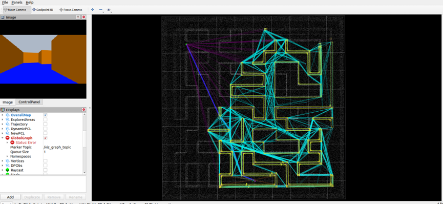
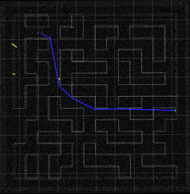

# AirFAR Gazebo Blender Exporter

**Blender → Gazebo Classic 11 → ROS Noetic / Air-FAR**, with one-click export of static UAV navigation environments.

[中文使用教程](docs/USAGE_ZH.md) · [Troubleshooting / 故障排查](docs/TROUBLESHOOTING_ZH.md) · [English quick start](README_EN.md) · [Releases](../../releases)

> **Maintainer:** [0rangEEEE](https://github.com/0rangEEEE) · [Repository](https://github.com/0rangEEEE/AirFAR-Gazebo-Blender-Exporter)

> **Project scope.** This is a community-developed Blender add-on and simulation adapter, **not an official Air-FAR project**. It exports Gazebo *map assets*; navigation performance depends on the downstream planner and sensing configuration. The current one-click installation is tailored to the Air-FAR `vehicle_simulator` ROS package.



## Why this project?

Hand-built Blender scenes can be inconvenient to reuse in UAV navigation experiments: OBJ/MTL colors may not survive Gazebo Classic rendering, collision geometry may be missing, the drone spawn pose may be inconsistent, and the ROS launch/world paths must be edited manually. **v0.3 standardizes this workflow** by exporting the relevant assets in one operation.

## Features

| Capability | Implementation |
|---|---|
| Static scene geometry | Export Blender mesh objects to `visual.obj` (meters, world transforms applied) |
| Pure-color material support | Read Principled BSDF **Base Color**; split OBJ by material and write explicit SDF `ambient/diffuse` colors |
| Render stability | Export face normals, set low emissive contribution and world ambient lighting |
| Collision geometry | `COL_BOX_...` box proxies, `COL_...` mesh proxies, or fallback to visual geometry |
| Drone initial pose | Read Blender Empty named `UAV_SPAWN` (XYZ + yaw) |
| Model / world | Generate Gazebo `model.sdf`, `model.config`, `.world` |
| RViz visual overview | Generate static sampled `preview/pointcloud.ply` (visualization only) |
| Air-FAR integration | ZIP bundle, installer, generated `start_<map>.launch` |
| Repeatable export | Clears stale generated files in the export directory before rebuilding |

**Not supported/verified:** full Blender PBR or procedural shaders, faithful texture/lighting reproduction, dynamic objects or animation, universal EGO/FAST-Planner launch integration, or guaranteed collision-free autonomous navigation.

## Tested environment and prerequisites

- **Blender 4.2+** (minimum version declared in the extension manifest).
- **Ubuntu 20.04**, **ROS Noetic**, **Gazebo Classic 11** for the Air-FAR integration.
- Existing, built ROS workspaces: [`Bottle101/Air-FAR`](https://github.com/Bottle101/Air-FAR) and [`Bottle101/aerial_autonomy_development_environment`](https://github.com/Bottle101/aerial_autonomy_development_environment) (use the matching ROS Noetic branch / fork as appropriate).
- Python 3 available on Ubuntu. No additional Python dependency is required for `install_map.py` beyond the standard library.

> The `maze` environment has been demonstrated with Ubuntu 20.04, ROS Noetic and Gazebo Classic 11. Compatibility with other Blender, ROS and Gazebo versions is not established.

## 🚀 Example: `maze` (Blender source + Gazebo bundle)

The repository includes an editable [`maze.blend`](examples/maze/maze.blend) source scene and a ready-to-install [`maze_gazebo_bundle.zip`](examples/maze/maze_gazebo_bundle.zip) for Gazebo Classic / Air-FAR.

With a prebuilt ROS Noetic + Air-FAR simulator workspace, copy the example map ZIP to Ubuntu `~/下载/` and run:

```bash
MAP=maze
WS="$HOME/airfar_ws/aerial_autonomy_development_environment"
IMPORT="$HOME/airfar_map_import/${MAP}_$(date +%Y%m%d_%H%M%S)"
mkdir -p "$IMPORT"
unzip -o "$HOME/下载/${MAP}_gazebo_bundle.zip" -d "$IMPORT"
cd "$IMPORT" || exit 1
python3 install_map.py --workspace "$WS"
```

**Terminal 1 — Gazebo / simulator**

```bash
source /opt/ros/noetic/setup.bash
source "$HOME/airfar_ws/aerial_autonomy_development_environment/devel/setup.bash"
roslaunch vehicle_simulator start_maze.launch
```

**Terminal 2 — Air-FAR / RViz**

```bash
source /opt/ros/noetic/setup.bash
source "$HOME/airfar_ws/aerial_autonomy_development_environment/devel/setup.bash"
source "$HOME/airfar_ws/Air-FAR/devel/setup.bash"
roslaunch airfar_planner airfar.launch config_file:=default rviz_file:=airfar_tunnel
```

In RViz, select **Goalpoint3D** to navigate. The initial pose stored in the example is **(-2.865, -8.800, 3.691) m**, yaw 0. The package contains two material groups and a full-map RViz preview cloud; the latter **does not constitute online sensor data or automatic planning prior knowledge**.

📖 [Example files, Blender re-export, runtime diagnostics and limitations](examples/maze/README.md)

## Create your own map (Blender → Gazebo → Air-FAR)

### 1. Install the Blender add-on

Download **`AirFAR_Gazebo_Blender_Addon_v0_3.zip`** from [Releases](../../releases) or [`dist/`](dist/). **Do not unzip this add-on ZIP.** In Blender: **Edit → Preferences → Get Extensions → Install from Disk**, select the ZIP, then enable the add-on. In the 3D Viewport, press `N` → **Gazebo** tab → **Air-FAR Gazebo Map**.

### 2. Prepare and export a map

1. Model walls/floor in Blender. Use **Principled BSDF → Base Color** for simple solid colors. `1 Blender Unit = 1 m` is the recommended convention.
2. Add an **Empty** exactly named `UAV_SPAWN`, put it at the desired XYZ (Z above the floor) and set its yaw by rotating around Z.
3. Optional: model collision proxies starting with `COL_BOX_` (box) or `COL_` (mesh). If none exist, the exporter uses all visible meshes as collision geometry.
4. On the add-on panel, set **Map name** to `maze` (or another map identifier), **Output folder**, tick **Create ZIP**, click **One-click Export for Gazebo**.
5. Transfer `<map>_gazebo_bundle.zip` into the Ubuntu VM's `~/下载/` directory.

### 3. Install the exported map in Ubuntu

Replace only `MAP` with the map name entered in Blender. Replace `WS` if your simulator workspace is elsewhere.

```bash
MAP=maze
WS="$HOME/airfar_ws/aerial_autonomy_development_environment"
BUNDLE="$HOME/下载/${MAP}_gazebo_bundle.zip"
IMPORT="$HOME/airfar_map_import/${MAP}_$(date +%Y%m%d_%H%M%S)"

mkdir -p "$IMPORT"
unzip -o "$BUNDLE" -d "$IMPORT"
cd "$IMPORT" || exit 1
python3 install_map.py --workspace "$WS"
```

The installer backs up existing destination files, installs the Gazebo model, `.world` and preview cloud, and derives the launch configuration from the workspace `system_gazebo.launch`.

### 4. Run Air-FAR (two terminals)

**Terminal 1 — simulator / Gazebo:**

```bash
MAP=maze
source /opt/ros/noetic/setup.bash
source "$HOME/airfar_ws/aerial_autonomy_development_environment/devel/setup.bash"
roslaunch vehicle_simulator "start_${MAP}.launch" gazebo_gui:=true
```

**Terminal 2 — planner / RViz:**

```bash
source /opt/ros/noetic/setup.bash
source "$HOME/airfar_ws/aerial_autonomy_development_environment/devel/setup.bash"
source "$HOME/airfar_ws/Air-FAR/devel/setup.bash"
roslaunch airfar_planner airfar.launch config_file:=default rviz_file:=airfar_tunnel
```

In RViz, use **Goalpoint3D** to assign an Air-FAR goal. `Waypoint3D` is for the simulator/local-planner waypoint interface, not equivalent to the Air-FAR global target.



## What the exporter writes

```text
maze_gazebo_bundle.zip
├── install_map.py
├── manifest.json                 # spawn XYZ/yaw, triangle/point counts, warnings
├── README.txt
├── model/maze/
│   ├── model.config
│   ├── model.sdf
│   ├── meshes/
│   │   ├── visual.obj
│   │   ├── visual.mtl
│   │   ├── visual_mat_000.obj     # visual mesh separated by material
│   │   ├── visual_mat_001.obj
│   │   └── collision_0000.stl    # or SDF <box> collision proxies
│   └── preview/pointcloud.ply
├── world/maze.world
└── launch/start_maze.launch
```

The number of material groups and colliders depends on the source Blender scene.

The installed model lives at `~/.gazebo/models/<map>/`. The Air-FAR simulator workspace receives the world, launch and static RViz preview cloud. A complete sample map is bundled under [`examples/maze/`](examples/maze/).

**Mapping / prior knowledge boundary:** `preview/pointcloud.ply` represents the *whole exported scene* for visualization. It is **not itself online LiDAR data** and should not be treated as proof that Air-FAR has or lacks a preloaded planning map; verify ROS publishers/subscribers if testing unknown-environment navigation.

## Troubleshooting snapshot

```bash
source /opt/ros/noetic/setup.bash
pgrep -af 'gzserver|gzclient'
rosparam get /vehicleSimulator/vehicleX
rosparam get /vehicleSimulator/vehicleY
rosparam get /vehicleSimulator/vehicleZ
rosparam get /vehicleSimulator/vehicleYaw
timeout 6s rostopic hz /registered_scan
rostopic info /way_point
rostopic info /path
timeout 6s rostopic hz /path
rostopic info /attitude_control
rostopic info /goal
rostopic info /overall_map
```

For diagnosis of black meshes, incorrect spawn, Gazebo port 11345 conflicts, planner stops and noisy TF warnings, see [Troubleshooting](docs/TROUBLESHOOTING_ZH.md). Do not confuse global graph edges with the continuously executed local path.

## Source vs installation archive

- `addon/` — human-readable Blender add-on Python files and extension metadata.
- `dist/AirFAR_Gazebo_Blender_Addon_v0_3.zip` — **installable Blender extension ZIP**. This is *not* the ZIP exported by Blender for a map.
- `docs/` — usage and troubleshooting documentation.

**Important:** Two ZIP formats exist: `(A) Add-on ZIP` installs into Blender; `(B) *_gazebo_bundle.zip` is generated *by* Blender and gets installed in Ubuntu. Do not swap them.

## Credits and licensing

Maintainer: [0rangEEEE](https://github.com/0rangEEEE). This is an independent community exporter and not an official Air-FAR project. Air-FAR, Blender, Gazebo and ROS remain separate projects with their own licenses.

The exporter is distributed under the [MIT License](LICENSE). Rights to distribute the `maze.blend` scene and derived map are subject to the original asset authorization; see [example asset notice](examples/maze/ASSET_NOTICE.md).
